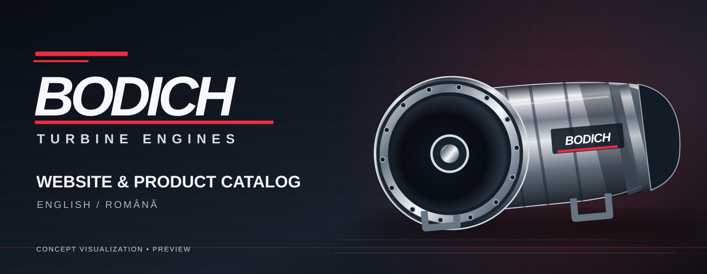

<p align="center">
  
</p>

<h1 align="center">BODICH — Turbine Website</h1>

<p align="center">
  Bilingual company website and product catalog for turbine engines, built for a future online store.
</p>

<p align="center">
  <a href="https://github.com/YuriiSokolenko/bodich/actions/workflows/ci.yml"></a>
  
  
  
  
</p>

> [!IMPORTANT]
> **Development preview — not a live store.** BODICH products, specifications, contact details, pricing, stock, legal policies and production domain are not confirmed or published. No orders or payments can be placed. The turbine artwork above is an **original conceptual illustration**, not a photograph of an existing BODICH product.

## About

**BODICH** is a bilingual (English / Romanian) website project for presenting model aviation turbine engines and related accessories. The initial release is focused on product discovery, technical content and a responsive corporate website. A shopping experience is planned as a **separate future phase**.

**Română:** BODICH este un proiect de website bilingv (engleză / română) pentru prezentarea turbinelor destinate aeromodelismului și a accesoriilor. Catalogul și informațiile despre companie sunt în curs de pregătire; vânzările online vor fi adăugate ulterior.

### Current scope

| Area | Status |
| --- | --- |
| Astro + TypeScript + Tailwind CSS foundation | ✅ Implemented |
| English and Romanian navigation | ✅ Implemented |
| Responsive shared page layout | ✅ Initial implementation |
| Product, Accessories, Support, About and Contact routes | ✅ Placeholder pages |
| BODICH brand and README illustration | 🎨 Concept |
| Design system and polished storefront UI | 🚧 Phase 2 |
| Real product catalog, images and verified specifications | 📋 Planned |
| Contact information and functioning inquiry forms | 📋 Awaiting company details |
| Shopping cart, checkout, payment and order management | 🔒 Not enabled |

## Technology

| Part | Implementation |
| --- | --- |
| Site framework | [Astro 7](https://astro.build/) — static site generation |
| Application language | TypeScript (strict mode) |
| Styling | [Tailwind CSS 4](https://tailwindcss.com/) via Vite |
| Localization | Centralized EN / RO UI dictionaries |
| Runtime for development and CI | Node.js **24** |
| Package manager | npm with committed `package-lock.json` |
| Continuous integration | GitHub Actions |
| Intended static host | Cloudflare Pages (not deployed yet) |
| Future commerce | Separate integration after provider and requirements are chosen |

The architecture intentionally avoids a database, backend and checkout integration until real requirements make them necessary.

## Getting started

Prerequisites: Node.js 24 and npm. `.nvmrc` contains the expected Node.js major version.

```bash
git clone https://github.com/YuriiSokolenko/bodich.git
cd bodich
nvm use            # only if Node Version Manager is installed
npm ci
npm run dev
```

Astro prints the development URL (typically `http://localhost:4321`). Browse `/en/` or `/ro/`.

### Commands

| Command | Description |
| --- | --- |
| `npm run dev` | Start local development server |
| `npm run check` | Validate Astro components and TypeScript |
| `npm run build` | Generate the static website into `dist/` |
| `npm run preview` | Preview generated pages locally |

Use `npm ci` for reproducible installation from the committed lockfile. GitHub Actions runs installation, type checking, production build and route checks on pull requests.

## Pages and localization

The English locale is the default, and Romanian is available through an equivalent route. The root `/` redirects to `/en/`.

| Section | English | Română |
| --- | --- | --- |
| Home / Acasă | `/en/` | `/ro/` |
| Products / Produse | `/en/products/` | `/ro/products/` |
| Accessories / Accesorii | `/en/accessories/` | `/ro/accessories/` |
| Support / Asistență | `/en/support/` | `/ro/support/` |
| About Us / Despre noi | `/en/about/` | `/ro/about/` |
| Contact | `/en/contact/` | `/ro/contact/` |

Translated UI strings and route helpers live in [`src/i18n/index.ts`](src/i18n/index.ts). Shared navigation preserves the active section when changing language. Actual localized catalog content will be introduced separately.

## Project organization

```text
.github/workflows/ci.yml    # type checking, build and route checks
docs/assets/                # brand concepts and project illustrations
public/                     # public static assets and crawler policy
src/
  components/               # shared header, footer and page components
  i18n/                     # English / Romanian translations and route helpers
  layouts/                  # shared page shell, metadata
  pages/
    en/                     # English routes
    ro/                     # Romanian routes
  styles/                   # Tailwind and global styles
astro.config.mjs            # Astro, locales and static build configuration
```

## Preview publishing and SEO

The current pages are intentionally marked `noindex, nofollow`; `public/robots.txt` also blocks crawling. This is **not an access-control mechanism**, and blocked crawlers may not see the `noindex` tag. Do not use the preview to host private information.

For production launch:

1. Confirm the company domain, legal information, contacts and published content.
2. Configure `SITE_URL` in the build environment to the real public URL, so canonical and `hreflang` links use the correct domain.
3. Replace the preview indexing rules with a consistent production strategy; add and verify the sitemap.
4. Set up Cloudflare Pages with build command `npm run build` and output directory `dist`.
5. Validate the English and Romanian pages, links, accessibility, performance and mobile layout before opening the site to search engines.

> `SITE_URL` is deliberately unset until a real domain is confirmed. Do not set it to the example URLs in this README.

## Roadmap

We develop in small, reviewed pull requests rather than deploying a large unfinished store all at once.

- ✅ [Phase 1 — site foundation and localization](https://github.com/YuriiSokolenko/bodich/issues/2) · [merged PR #3](https://github.com/YuriiSokolenko/bodich/pull/3)
- 🚧 [Phase 2 — visual identity, design system and responsive UI](https://github.com/YuriiSokolenko/bodich/issues/4)
- ⏳ Original turbine imagery, product categories, product detail pages, support and accessories
- ⏳ Localization review, production metadata, real contacts and deployment
- 🔒 Commerce backend, prices, inventory, cart, checkout and payment integration — **after website launch approval**

The [master roadmap and acceptance requirements are in Issue #1](https://github.com/YuriiSokolenko/bodich/issues/1).

## Brand and content policy

The [KingTech Turbines](https://www.kingtechturbines.com/) website is a reference for navigation and product discovery workflows **only**. BODICH uses its own brand identity, artwork and text; competitor photographs, logos and proprietary product descriptions are not reused. Concept turbine visualizations are labeled as such until actual product materials are provided.

Company contact information, product specifications, price lists, warranty terms and compliance statements must be confirmed before publication.

---

<p align="center"><strong>BODICH</strong> · English / Română · Website in development</p>
