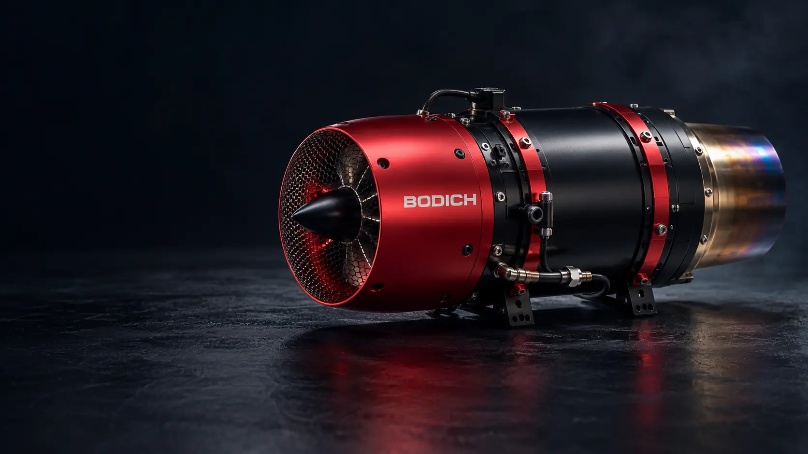

<p align="center">
  
</p>

<h1 align="center">BODICH — Turbine Website</h1>

<p align="center">
  Bilingual company website and product catalog for turbine engines, built for a future online store.
</p>

<p align="center">
  <a href="https://github.com/YuriiSokolenko/bodich/actions/workflows/ci.yml"></a>
  
  
  
  
</p>

> [!IMPORTANT]
> **Development preview — not a live store.** BODICH products, specifications, contact details, pricing, stock, legal policies and production domain are not confirmed or published. No orders or payments can be placed. The turbine artwork above is an **AI-generated concept rendering**, not a photograph of an existing BODICH product.

## About

**BODICH** is a bilingual (English / Romanian) website project for presenting model aviation turbine engines and related accessories. The initial release is focused on product discovery, technical content and a responsive corporate website. A shopping experience is planned as a **separate future phase**.

**Română:** BODICH este un proiect de website bilingv (engleză / română) pentru prezentarea turbinelor destinate aeromodelismului și a accesoriilor. Catalogul și informațiile despre companie sunt în curs de pregătire; vânzările online vor fi adăugate ulterior.

### Current scope

| Area | Status |
| --- | --- |
| Astro + TypeScript + Tailwind CSS foundation | ✅ Implemented |
| English and Romanian navigation | ✅ Implemented |
| Responsive shared page layout | ✅ Header implemented (2C); footer and shared UI components implemented (2D) |
| Product, Accessories, Support, About and Contact routes | ✅ Placeholder pages |
| BODICH brand and README hero image | 🎨 AI-generated concept |
| Shared colors, typography, spacing and radius tokens | ✅ Phase 2B |
| Final visual QA on mobile and desktop | 🚧 Phase 2E — not yet verified |
| Real product catalog, images and verified specifications | 📋 Planned |
| Contact information and functioning inquiry forms | 📋 Awaiting company details |
| Shopping cart, checkout, payment and order management | 🔒 Not enabled |

## Technology

| Part | Implementation |
| --- | --- |
| Site framework | [Astro 7](https://astro.build/) — static site generation |
| Application language | TypeScript (strict mode) |
| Styling | [Tailwind CSS 4](https://tailwindcss.com/) via Vite |
| Localization | Centralized EN / RO UI dictionaries |
| Runtime for development and CI | Node.js **24** |
| Package manager | npm with committed `package-lock.json` |
| Continuous integration | GitHub Actions |
| Intended static host | Cloudflare Pages (not deployed yet) |
| Future commerce | Separate integration after provider and requirements are chosen |

The architecture intentionally avoids a database, backend and checkout integration until real requirements make them necessary.

## BODICH design tokens

The website uses a **dark aerospace palette with steel neutrals and a red brand accent**, matching the direction of the BODICH turbine concept hero image. All styling tokens live in [`src/styles/global.css`](src/styles/global.css) using Tailwind CSS v4's `@theme` directive; no separate Tailwind configuration file is needed.

| Token / utility | Purpose | Value |
| --- | --- | --- |
| `bodich-canvas` | Base page background | `#080d15` |
| `bodich-panel`, `bodich-panel-raised` | Surface layers | `#111b27`, `#172332` |
| `bodich-ink`, `bodich-muted`, `bodich-dim` | Text hierarchy | `#f4f6fa`, `#b9c4d2`, `#8d9aa9` |
| `bodich-border` | Subtle structural separators | `#334052` |
| `bodich-control-border` | Higher contrast interactive outlines | `#77879a` |
| `bodich-accent`, `bodich-accent-hover` | Primary actions and emphasis | `#ff5264`, `#ff7685` |
| `bodich-accent-ink` | Text on filled accent backgrounds | `#10131a` |
| `font-sans`, `font-display` | Body and headline font stacks | System fonts; no remote loading (Arial fallback when Arial Black is unavailable) |
| `site-gutter`, `site-gutter-lg`, `site-section` | Small/large gutters and section spacing | `1.25rem`, `2rem`, `7rem` |
| `control`, `pill` | Control / pill border radius | `0.5rem`, `9999px` |

Use semantic utilities like `bg-bodich-panel`, `text-bodich-muted`, `hover:text-bodich-accent-hover`, `font-display`, `px-site-gutter`, `sm:px-site-gutter-lg` and `rounded-control` rather than scattering raw hex values across Astro components. The accent foreground/background pairing provides approximately 5.9:1 contrast (WCAG AA). The control outline token provides over 3:1 contrast against the canvas. Keyboard focus uses the shared accent-hover token, and scrolling respects reduced-motion preferences. The shared layout uses `min-h-dvh` to handle mobile browser viewports.

Phase 2B established the **tokens**. Subsequent PRs delivered navigation and shared components in phases 2C–2D; browser-based visual QA remains in [Phase 2E](https://github.com/YuriiSokolenko/bodich/issues/4).

## Shared UI components

The shared presentation layer now includes a responsive footer and three small, reusable Astro components:

| Component | Responsibility |
| --- | --- |
| [`SiteContainer.astro`](src/components/ui/SiteContainer.astro) | Consistent max-width and responsive page gutters |
| [`ActionLink.astro`](src/components/ui/ActionLink.astro) | Semantic navigational link with primary/secondary treatments |
| [`SurfaceCard.astro`](src/components/ui/SurfaceCard.astro) | Neutral bordered surface for content sections |

The [site footer](src/components/SiteFooter.astro) has localized **Explore** and **Company** navigation groups, uses the same real EN/RO placeholder routes as the header, and marks the active page with `aria-current="page"`. Footer navigation uses `aria-labelledby` with localized screen-reader suffixes and touch-friendly link heights. Global `:focus-visible` styling in `src/styles/global.css` applies to these links and to `ActionLink`. The shared section page now presents its placeholder introduction inside a `SurfaceCard`, a deliberate visual change awaiting mobile QA. It intentionally does not display unconfirmed phone numbers, email addresses, social accounts, dealers, payments or warranty information.

All visible footer strings are centralized in `src/i18n/index.ts`. Components are intentionally minimal; the upcoming visual QA stage will validate actual responsive rendering and accessibility.

## Responsive browser QA

The project includes a dedicated [Browser Visual QA GitHub Actions workflow](.github/workflows/visual-qa.yml) that serves a real production build in **headless Chromium** and checks English and Romanian layouts at **320px, 390px, 768px, 1024px, and 1440px**.

It validates navigation and language switching, active footer links, mobile menu keyboard and pointer dismissal, accessible labels, horizontal overflow, the keyboard skip link and color contrast. Each run attaches a ZIP artifact with full-page screenshots, mobile open-menu screenshots, `report.md`, and `report.json`.

The browser tests are implemented in [`scripts/visual-qa.mjs`](scripts/visual-qa.mjs). To run them locally, use Node.js 24 with the pinned Astro lockfile:

```bash
npm ci
npm run check
npm run build
npm install --no-save --package-lock=false playwright@1.64.1
npx playwright install --only-shell chromium
npm run preview -- --host 127.0.0.1 --port 4321
```

In a **second terminal** run:

```bash
VISUAL_BASE_URL=http://127.0.0.1:4321 node scripts/visual-qa.mjs
```

`VISUAL_BASE_URL` is optional and defaults to `http://127.0.0.1:4321`. The GitHub workflow handles these steps automatically: it builds from locked dependencies **before** installing transient browser tooling, and uploads screenshot artifacts for 14 days. Browser assertions cover additional text and focus-ring contrast, console/network failures, Escape focus return and the native no-JavaScript menu fallback.

**Automated browser passes are not a substitute for human visual inspection**, usability testing, native-speaker review of Romanian or real-device testing. Before public launch, review the captured EN/RO screenshots and mobile interactions.

## Getting started

Prerequisites: Node.js 24 and npm. `.nvmrc` contains the expected Node.js major version.

```bash
git clone https://github.com/YuriiSokolenko/bodich.git
cd bodich
nvm use            # only if Node Version Manager is installed
npm ci
npm run dev
```

Astro prints the development URL (typically `http://localhost:4321`). Browse `/en/` or `/ro/`.

### Commands

| Command | Description |
| --- | --- |
| `npm run dev` | Start local development server |
| `npm run check` | Validate Astro components and TypeScript |
| `npm run build` | Generate the static website into `dist/` |
| `npm run preview` | Preview generated pages locally |

Use `npm ci` for reproducible installation from the committed lockfile. GitHub Actions runs installation, type checking, production build and route checks on pull requests to `main` and pushes to `main` (plus a temporary bootstrap feature-branch trigger, pending CI cleanup).

## Pages and localization

The English locale is the default, and Romanian is available through an equivalent route. The root `/` redirects to `/en/`. Both locale versions are preliminary: Romanian copy needs native-speaker review before public launch.

| Section | English | Română |
| --- | --- | --- |
| Home / Acasă | `/en/` | `/ro/` |
| Products / Produse | `/en/products/` | `/ro/products/` |
| Accessories / Accesorii | `/en/accessories/` | `/ro/accessories/` |
| Support / Asistență | `/en/support/` | `/ro/support/` |
| About Us / Despre noi | `/en/about/` | `/ro/about/` |
| Contact | `/en/contact/` | `/ro/contact/` |

Translated UI strings and route helpers live in [`src/i18n/index.ts`](src/i18n/index.ts). Shared navigation preserves the active section when changing language. Actual localized catalog content will be introduced separately.

### Catalog information architecture

The Products and Accessories landing pages link to a **provisional bilingual taxonomy**:

| Section | English category route (replace `en` with `ro` for Romanian) |
| --- | --- |
| Products | `/en/products/turbine-engines/` |
| Accessories | `/en/accessories/ecu-controls/` |
| Accessories | `/en/accessories/fuel-systems/` |
| Accessories | `/en/accessories/electrical-components/` |
| Accessories | `/en/accessories/mounting-hardware/` |

The source of truth is [`src/catalog/data.ts`](src/catalog/data.ts): category IDs, bilingual labels and an intentionally **empty** `confirmedProducts` collection; [`src/catalog/index.ts`](src/catalog/index.ts) exposes shared catalog helpers. `ConfirmedCatalogProduct` reserves stable IDs/slugs, localized text, optional confirmed imagery and a mandatory company verification reference/date. **No models, prices, specifications, stock data or purchasing functionality are implied.** Category names are proposed navigation only.

`npm run check` includes [`scripts/validate-catalog.mjs`](scripts/validate-catalog.mjs), which validates non-empty source references, nonfuture ISO dates, unique IDs/slugs, category membership, bilingual copy and optional photos (approved catalog path, raster dimensions, common EXIF/GPS metadata and 5 MiB limit). It rejects all catalog image files not referenced by a confirmed product, because Astro would publish unreferenced files from `public/`. The check also runs in-memory negative regression fixtures to protect these rules when the product collection is empty. CI also uses the same taxonomy for the generated-route existence checks; it does not maintain a second hard-coded category list. The product fixture smoke test copies all git-tracked source/config files into a disposable workspace and swaps only the marked confirmed-product section; it remains valid after real product records are added. These automated checks validate data shape, **not the authenticity of company source documents**, which must be reviewed separately.

Category pages include localized breadcrumbs and metadata; the shared `hrefFor` helper keeps their URLs, language switching, canonical tags and hreflang links consistent (including nested deployment bases). CI additionally builds with `ASTRO_BASE=/bodich-preview` and verifies generated navigation, metadata, static image assets and redirects. When company-verified records are added to `confirmedProducts`, Astro generates linked product cards and localized model pages at `/{locale}/{section}/{category}/{slug}/`. These pages contain only verified bilingual names/summaries and optional company-provided photographs, with accessible image fallbacks, breadcrumbs, localized metadata and links to the matching category. No empty or invented product-detail routes are emitted: while the collection remains empty there are **zero public model pages**. The catalog validator also checks that generated model routes exist after build. Product prices, specifications, inventory, cart and checkout remain outside this phase. The existing AI-generated concept artwork stays labeled and separate from confirmed product photographs.

### Add a verified product

Follow [the verified catalog intake guide](docs/catalog/README.md). Complete the [intake JSON template](docs/catalog/intake-template.json) from authoritative BODICH materials, then run `npm run catalog:intake -- path/to/candidate.json`. The command checks the candidate without writing to the public catalog. Only after human review of sources, image rights and translations should the approved record be added to the marked `confirmedProducts` array; CI then validates the resulting localized model pages.

## Project organization

```text
.github/workflows/ci.yml    # type checking, build and route checks
docs/assets/                # brand concepts; legacy SVG banner retained for reference
public/                     # public static assets and crawler policy
src/
  components/               # localized header, footer and shared page components
    ui/                     # reusable SiteContainer, ActionLink and SurfaceCard
  i18n/                     # English / Romanian translations and route helpers
  layouts/                  # shared page shell, metadata
  pages/
    en/                     # English routes
    ro/                     # Romanian routes
  styles/                   # Tailwind and global styles
astro.config.mjs            # Astro, locales and static build configuration
```

## Preview publishing and SEO

The current pages are intentionally marked `noindex, nofollow`; `public/robots.txt` also blocks crawling. This is **not an access-control mechanism**, and blocked crawlers may not see the `noindex` tag. Do not use the preview to host private information.

For production launch:

1. Confirm the company domain, legal information, contacts and published content.
2. Configure `SITE_URL` in the build environment to the real public URL, so canonical and `hreflang` links use the correct domain.
3. Replace the preview indexing rules with a consistent production strategy; add and verify the sitemap.
4. Set up Cloudflare Pages with build command `npm run build` and output directory `dist`.
5. Validate the English and Romanian pages, links, accessibility, performance and mobile layout before opening the site to search engines.

> `SITE_URL` is deliberately unset until a real domain is confirmed. Do not set it to the example URLs in this README.

## Roadmap

We develop in small, reviewed pull requests rather than deploying a large unfinished store all at once.

- ✅ [Phase 1 — site foundation and localization](https://github.com/YuriiSokolenko/bodich/issues/2) · [merged PR #3](https://github.com/YuriiSokolenko/bodich/pull/3)
- 🚧 [Phase 2 — visual identity, design system and responsive UI](https://github.com/YuriiSokolenko/bodich/issues/4)
- ✅ Responsive turbine concept imagery and provisional bilingual catalog categories/routes
- ⏳ Verified product models, product detail pages, support and accessories data
- ⏳ Localization review, production metadata, real contacts and deployment
- 🔒 Commerce backend, prices, inventory, cart, checkout and payment integration — **after website launch approval**

The [master roadmap and acceptance requirements are in Issue #1](https://github.com/YuriiSokolenko/bodich/issues/1).

## Brand and content policy

The [KingTech Turbines](https://www.kingtechturbines.com/) website is a reference for navigation and product discovery workflows **only**. BODICH uses its own brand identity, artwork and text; competitor photographs, logos and proprietary product descriptions are not reused. Concept turbine visualizations are labeled as such until actual product materials are provided.

Company contact information, product specifications, price lists, warranty terms and compliance statements must be confirmed before publication.

---

<p align="center"><strong>BODICH</strong> · English / Română · Website in development</p>
